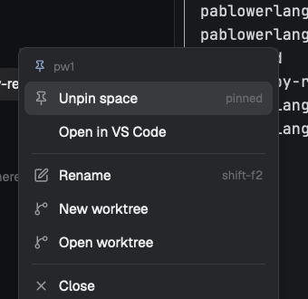

# Herdr Space Actions

Right-click a **space** in Herdr's sidebar for two extra actions:

- **Pin space / Unpin space** — the space stays even when every terminal and agent in it is closed.
- **Open in VS Code** — opens the space's current folder in VS Code.

The menu keeps the existing Rename, New worktree / Open worktree / Remove worktree, and Close items.



## Pin behavior

Pinning writes the space id to `shared("spaces.pinned")` and adds a **Pinned space** tab backed by the `space-pin` mod. That tab is a placeholder, not a terminal: if every terminal and agent in the space closes, the placeholder tab is still there, so the space remains. The sidebar row shows a pin icon while it is pinned.

Unpinning closes the placeholder tab. If it was the only tab left, the space closes (normal behavior). The explicit **Close** item still closes the space; the pin protects against an empty space, not against choosing Close.

## Open in VS Code

- Local space: `code -n <folder>`.
- Remote space: `code --remote ssh-remote+<target> -n <folder>`, where `<target>` comes from `hc machine ls --json`. The remote must be configured in VS Code Remote SSH and the `code` CLI must be in `PATH`.

The folder is the first live terminal's current folder, else the space's creation folder.

## Requirements

- Herdr app.
- VS Code only for the **Open in VS Code** action: install the `code` command in `PATH`.
- Remote spaces additionally need VS Code Remote SSH and an SSH target known to Herdr.

## Install

Sync the three mods into `~/.config/herdr-app/mods/`, then point a **personal layout** at the clone:

```json
{
  "id": "spaces",
  "type": "block",
  "content": { "mod": "spaces-plus" }
}
```

Keep the shipped `spaces` mod untouched. If the layout is shipped, clone it first:

```sh
herdr-app do layout.clone --name main --as my-layout
```

Then:

```sh
herdr-app check ~/.config/herdr-app/mods/spaces-plus
herdr-app check ~/.config/herdr-app/mods/space-menu
herdr-app check ~/.config/herdr-app/mods/space-pin
herdr-app status
```

## Repository

Source of truth for the three mods. After edits:

```sh
./sync.sh
```

It syncs `spaces-plus`, `space-menu`, and `space-pin` to the live Herdr folder and runs `herdr-app check` for each. See `AGENTS.md`.

## Publish

This repo is an app-mod repo. To share it on `herdr.dev/mods`:

- keep `mods/spaces-plus`, `mods/space-menu`, and `mods/space-pin` at the root;
- keep `RECIPE.md` and `preview.png`;
- add the topic `herdr-mod`;
- make the repository public.

See `.agents/skills/herdr-publish/SKILL.md` and `references/publishing.md` for the full checklist.
