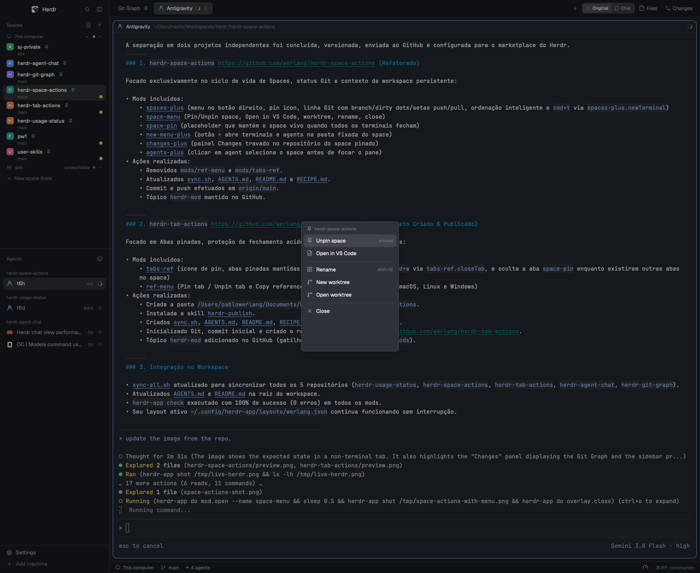

# Space Actions

Right-click a space in Herdr's sidebar for **Pin space** and **Open in VS Code**, alongside the usual rename/worktree/close items.

## What you see

The spaces sidebar gains a small pin icon on pinned rows. Right-clicking a space opens a compact menu with a header showing the space name, then:

- **Pin space** / **Unpin space** — pinned rows show the pin icon.
- **Open in VS Code** — opens the space's folder in a new VS Code window.
- separator
- **Rename**
- **New worktree** / **Open worktree** (and **Remove worktree** for a linked worktree)
- separator
- **Close**

The menu is keyboard-navigable: ↑/↓ move, Enter runs, Esc closes.

## How it behaves

- Pinning stores the space id in `shared("spaces.pinned")`, locks its location in `shared("spaces.pinned_locations")`, and creates a **Pinned space** tab backed by `space-pin`. If every terminal/agent in the space closes, the placeholder tab remains, so the space stays.
- After pinning, the space's location is fixed: terminal `cd` commands do not alter the space's location or its sidebar git info. Only unpinned spaces follow terminal `cd`.
- The **Changes** panel (`changes-plus`) keeps showing the pinned project's changes, and its Git Graph button opens the graph for that same project, even when a terminal in the space has `cd`'d elsewhere.
- Opening a new terminal or agent via the UI `+` button (`new-menu-plus`) opens directly in the space's folder (or fixed pinned location), rather than the current directory of the focused terminal.
- `spaces-plus.newTerminal`, optionally bound to `cmd+t`, starts a tab in the pinned location; unpinned spaces keep Herdr's default.
- Clicking an agent in the **Agents** panel (`agents-plus`) selects that agent's space before showing its pane, so the Spaces list and the Changes/Files panels follow the agent. Sub-agent rows select the parent's space before peeking.
- The placeholder tab shows the pin icon, the space name, the folder, and a **New terminal** button.
- Unpinning closes the placeholder tab and unlocks its location to follow terminal `cd` again. If it was the only tab, the space closes normally.
- **Close** still closes the space explicitly; the pin protects against an empty space, not against Close.
- **Open in VS Code** runs `code -n <folder>` locally. For a remote space it runs `code --remote ssh-remote+<target> -n <folder>`, resolving the SSH target from `hc machine ls --json`.
- For pinned spaces, the folder is the fixed pinned location. For unpinned spaces, the folder is the first live terminal's current folder, else the space's creation folder.

## Built from

- `mods/spaces-plus/` — clone of the shipped `spaces`; right-click opens `space-menu`, rows show `pin.svg` for pinned ids, and it answers `spaces-plus.newTerminal` with the pinned folder.
- `mods/space-menu/` — the popup menu, items, icons, keyboard handling, pin toggle, VS Code launch, and the existing worktree/close actions. It reads `shared("spaces.pinned")` and uses `tab.new`/`tab.close` for the placeholder.
- `mods/space-pin/` — the placeholder pane; `tab.new { mod: "space-pin", props: { space } }` keeps a tab in the space alive.
- `mods/new-menu-plus/` — the `+` menu clone ensuring new terminals and agents launch in the space's folder instead of the focused terminal's cd folder.
- `mods/changes-plus/` — clone of the shipped `changes` panel; reads `shared("spaces.pinned_locations")` for the active space and ships its own icons.
- `mods/agents-plus/` — clone of the shipped `agents` panel; row clicks run `space.select` for the agent's space before `pane.focus` (sub-agent rows select the parent's space before `terminal.peek`).
- `shared("spaces.pinned")` — app-wide pinned space ids.
- `hc(["machine", "ls", "--json"])` — remote SSH target for VS Code.
- The personal layout `werlang.json` points the `spaces` block at `spaces-plus` and the `agents` block at `agents-plus`.

## Watch out

- The pinned placeholder is a real tab named **Pinned space**. The active `tabs-ref` tab bar hides it while the space has other tabs; it appears only when it is the only tab left. That is what keeps the space alive without an extra visible tab.
- If the user closes the placeholder tab itself and no other tabs remain, the space closes. Re-pin it or keep at least one tab.
- Remote pinning depends on the remote core accepting a mod tab; the VS Code remote action assumes the Herdr machine target is a valid VS Code Remote SSH host.
- The `code` CLI must be in `PATH`; without it the action reports a notification instead of opening VS Code.
- Do not rename `spaces-plus`, `space-menu`, or `space-pin`: the asset paths and `openOverlay`/`tab.new` references use those names.
- The shipped `spaces`, `changes`, and `agents` mods remain untouched; only the personal layout points at the clones.

## Done when

- `herdr-app check` passes for `spaces-plus`, `changes-plus`, `space-menu`, `space-pin`, and `agents-plus`.
- Right-clicking a space shows Pin/Unpin and Open in VS Code, plus the existing items.
- Pinning adds the Pinned space tab and the row pin icon; closing all terminals/agents leaves the space.
- Unpinning removes the placeholder; if the space is empty it closes normally.
- Open in VS Code opens the right folder (or reports a clear error when `code` is missing).
- `herdr-app status` reports no errors.
